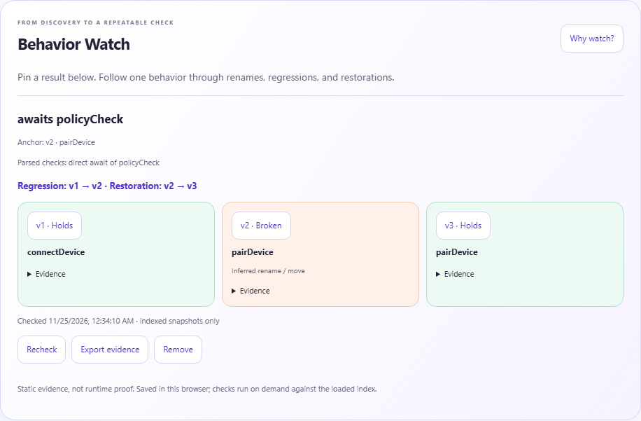

# CodeStrata

**Find where a JavaScript function changed and see the lines that explain it.**

CodeStrata searches a project's Git history for changes in how a function is written. Ask a question such as “Where did device pairing stop waiting for the policy check?” and it shows the matching versions, highlights the relevant source, and lets you save the rule to check again after you add more commits.

[Try the demo](#try-the-demo) · [Use your own repository](#use-your-own-repository) · [How it works](#how-it-works) · [Validation](#validation)

## One change across three versions

In the built-in demo, a function moves to a new file and gets a new name. It still calls `policyCheck`, but the refactor drops the `await`. A search for the call alone would find all three versions. CodeStrata compares how the call is made and shows where the wait disappeared.

| Version | Source | What CodeStrata finds |
| --- | --- | --- |
| v1 | `devices/connect.js` · `connectDevice` | `await policyCheck(device)` — **Holds** |
| v2 | `flows/pair.js` · `pairDevice` | `policyCheck(device)` — **Broken** |
| v3 | `flows/pair.js` · `pairDevice` | `await policyCheck(device)` — **Holds** |

**Holds** and **Broken** describe whether the source matches the saved rule. The demo checks for a direct `await`. Runtime behavior requires separate testing.



## Try the demo

You need Git and Node.js **22.22.2+ on the 22 release line, 24.15+ on the 24 release line, or 26+**. After installing the dependencies, the default demo runs locally on a CPU and needs no API key or Python.

```sh
git clone https://github.com/AdvayV/AgenticIntelligence.git
cd AgenticIntelligence
npm ci --omit=optional
npm start
```

1. Open [http://127.0.0.1:3000](http://127.0.0.1:3000) and select **Investigate the refactor**. The first result is `pairDevice@v2`.
2. In the first result, compare the highlighted line with the v1 example, which still has the `await`. Select `connectDevice` on the timeline to open its source.
3. Select **Watch behavior** on the result. Keep the rule `awaits policyCheck` and select **Save and check**. The watch shows **v1 Holds → v2 Broken → v3 Holds**. Select a point to inspect its source, or select **Export evidence** to download the report as JSON.

On Windows PowerShell, use `npm.cmd` in place of `npm` if the execution policy blocks `npm.ps1`. If port 3000 is busy, set `$env:PORT = '3001'` in PowerShell or run `PORT=3001 npm start` in Bash, then open port 3001 in your browser.

<details>
<summary>Run with Docker</summary>

```sh
docker build -t codestrata .
docker run --rm -p 127.0.0.1:3000:3000 codestrata
```

Open [http://127.0.0.1:3000](http://127.0.0.1:3000) after the container starts.

</details>

## Use your own repository

From the CodeStrata folder, point the indexer at a local JavaScript or JSX Git repository. Replace the path and function names with ones from your project.

```sh
npm run index -- --repo "/path/to/repo" --history 20 --out .codestrata/history.json
npm run search -- --out .codestrata/history.json --query "calls validateInput before executeTool" --top-k 3
```

To open that index in the browser, run `CODESTRATA_INDEX=.codestrata/history.json npm start` on macOS or Linux. In PowerShell, run `$env:CODESTRATA_INDEX = '.codestrata/history.json'` and then `npm.cmd start`. Reindex and restart when you want to include newer commits.

## How it works

1. **Read the source.** Babel parses JavaScript and JSX and records functions, source lines, calls, and direct awaits from each indexed revision. CodeStrata only reads the indexed project's code.
2. **Search and compare.** A local search process combines keyword and vector matches, examines the candidate source, and shows a nearby version when it provides a useful comparison. Its decision trace is visible in the app.
3. **Follow the function.** CodeStrata can link some renamed or moved functions based on shared code structure. It leaves ambiguous matches unresolved.
4. **Save a check.** A Behavior Watch follows the selected function through the linked versions and evaluates a rule such as `awaits policyCheck`. Each result points back to the relevant source.

The default search uses local feature vectors and a deterministic planner. See how the index and optional CPU models work. [Architecture notes](docs/architecture.md)

**Scope.** The parser supports JavaScript and JSX. Queries work best when you name a function or call. Complex branches, delayed awaits, repeated calls, and ambiguous refactors can leave a result unverified. [Evidence rules](docs/architecture.md)

## Validation

| Check | Measured result | Scope |
| --- | --- | --- |
| Version challenge | 8 of 8 correct first results | Synthetic development examples that overlap the demo |
| Async and Express retrieval | 0.6717 and 0.8577 NDCG@10 with BGE | 60 source-reviewed, partly AI-assisted queries across two pinned repositories |
| MTEB AppsRetrieval | 0.15711 NDCG@10 with Jina code q8 | Encoder benchmark on Python retrieval tasks |

NDCG@10 measures how well the first ten search results are ranked. Each row covers a different test. [Validation methods and raw results](docs/validation.md)

Run `npm run check`, `npm test`, and `npm run evaluate` for local checks. For browser tests, install the browsers with `npx playwright install chromium firefox`, then run `npm run test:browser`. [GitHub Actions](https://github.com/AdvayV/AgenticIntelligence/actions/workflows/ci.yml)

## Team and submission

Built by **Advay Vivek** and **Kaavish Gogia** at **Vellore Institute of Technology** for the Agentic Code Intelligence track of the PRISM GenAI hackathon.

[Submission PDF](submission-documents/VITUniversity_CodeStrata.pdf) · [Slides](submission-documents/VITUniversity_CodeStrata.pptx) · [AI disclosure](submission-documents/CodeStrata-AI-Disclosure.docx) · [Submission tag](https://github.com/AdvayV/AgenticIntelligence/tree/PRISM_GENAI_HACKATHON_Y2026)
